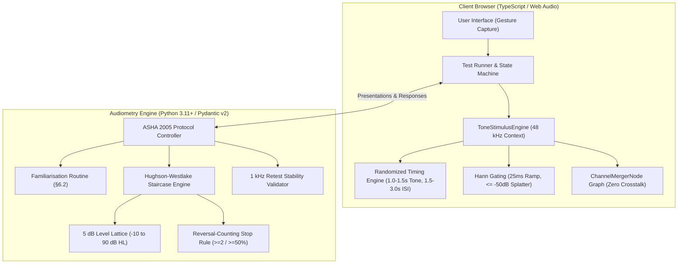

# AuroHear v2

> **A publication-ready, standards-compliant pure-tone threshold screening audiometer and digital audiology platform.**

[](https://www.asha.org)
[](https://www.thebsa.org.uk)
[](#standards-compliance)
[](https://www.python.org/)
[](https://www.typescriptlang.org/)
[](LICENSE)

---

## Executive Summary

**AuroHear v2** is an open-source, digital audiology system engineered for unsupervised and clinician-assisted air-conduction pure-tone threshold audiometry in standard modern web browsers.

Consumer web hearing tests routinely suffer from acoustic artifacts (transient clicks), lack of strict calibration limits, premature trial termination, and arbitrary decibel cutoffs. AuroHear v2 resolves these systematic errors by implementing:

1. **Mathematically Rigorous Adaptive Staircase (Hughson–Westlake)**: Ascending reversal-counting termination criteria ($ \ge 2 $ responses out of $ \ge 50\% $ ascending presentations) spanning −10 dB HL to 90 dB HL.
2. **Click-Free Web Audio Stimulus Engine**: Isolated dual-node gain architecture executing sampled Hann rise/fall envelopes (20–50 ms) to suppress transient spectral splatter ($ \le -50\text{ dB} $ off-frequency energy).
3. **Crosstalk Immunity by Construction**: Direct channel routing via Web Audio `ChannelMergerNode` ensuring absolute zero signal in the non-test ear.
4. **ASHA 2005 Protocol Sequencing**: Standardized test order starting at 1000 Hz, inter-octave evaluation, and automated 1000 Hz retest verification ($ |\Delta| > 5\text{ dB} $ session flagging).
5. **Rigorous Statistical & Property-Based Verification**: Validated via Hypothesis property testing, fast-check generative tests, and a 2,000-listener Monte Carlo simulation study.

---

## Standards Compliance

AuroHear v2 is developed against the following clinical and engineering benchmarks:

* **ASHA (2005)**: *Guidelines for Manual Pure-Tone Threshold Audiometry*
* **BSA (2018)**: *Recommended Procedure: Pure-tone air-conduction and bone-conduction threshold audiometry* (OD104-32)
* **ISO 8253-1 / ANSI S3.21**: *Acoustics — Audiometric test methods — Part 1: Pure-tone air and bone conduction audiometry*
* **IEC 60645-1**: *Electroacoustics — Audiometric equipment — Part 1: Equipment for pure-tone audiometry*
* **WHO (2021)**: *World report on hearing* (Hearing impairment grading and classification)

Detailed specifications and architectural analysis:
* [Browser Audiometry Digitization Spec](Browser_audiometry_digitization_spec.md)
* [Gap Analysis: V1 Prototype vs. Clinical Requirements](docs/GAP_ANALYSIS.md)
* [Conference Upgrade Strategy & Roadmap](docs/CONFERENCE_UPGRADE_STRATEGY.md)

---

## System Architecture



### 1. Pure-Tone Threshold Engine (`backend/src/aurohear/audiometry`)
A pure, event-driven core isolated from audio I/O and wall-clocks:
* **Level Lattice (`levels.py`)**: Quantized 5 dB grid from −10 dB HL up to 90 dB HL. Rejects arbitrary capping (e.g., v1's 40 dB HL limitation).
* **Clinical Models (`models.py`)**: Immutable Pydantic v2 domain schemas for `Presentation`, `StaircaseTrial`, `ThresholdResult`, and `ProtocolResult`. Enforces clinical validity at object creation.
* **Modified Hughson–Westlake (`staircase.py`)**: Strict 10 dB down on response, 5 dB up on non-response. Only ascending runs count toward threshold calculation.
* **Familiarisation (`familiarisation.py`)**: §6.2 procedure starting at 40 dB HL with stepped ascent until two consecutive responses at the same level.
* **ASHA 2005 Sequence & Inter-Octaves (`protocol.py`)**: Standard order (1000 → 2000 → 3000 → 4000 → 6000 → 8000 → 1000 retest → 500 → 250 Hz) with dynamic inter-octave insertion (750 Hz and 1500 Hz on $\ge 20\text{ dB}$ adjacent octave difference per §6.4).
* **Quality Check (QC) Probes (`qc_probe.py`)**: Post-threshold confirmation tones at threshold and threshold + 5 dB, calculating probe fail rates for QUALIND indicator #7.
* **Per-Frequency Headphone Ceilings**: Synchronized hardware caps between client profile and backend engine lattices, preventing clipping mismatches.

### 2. Acoustic Stimulus Engine (`frontend/src/audio`)
High-precision audio synthesis built on standard Web Audio primitives:
* **AudioContext Initialization (`ToneStimulusEngine.ts`)**: Bootstrapped strictly within user gestures at a 48 kHz sample rate.
* **Crosstalk Elimination**: Audio signal routes exclusively through a `ChannelMergerNode`. The untested ear channel remains completely disconnected, eliminating pan-law leakage by physical construction.
* **Hann Rise/Fall Windowing (`envelope.ts`)**: Sample-rate-accurate curve generated via `setValueCurveAtTime` (25 ms nominal, configurable 20–50 ms). Eliminates audible clicks and spectral artifacts.
* **Temporal Randomization (`timing.ts`)**: Uniformly distributed stimulus duration ($1.0\text{--}1.5\text{ s}$) and inter-stimulus interval ($1.5\text{--}3.0\text{ s}$). Enforces $\text{ISI} \ge \text{Tone Duration}$ on every draw to prevent rhythmic anticipation.
* **Transducer Calibration & Safety Clamping (`calibration.ts`)**: Converts dB HL to linear gain based on headphone profile offsets. Clamps output to hardware ceilings ($\le 90\text{ dB HL}$) and records Quality Control (QC) clamp events.

### 3. Clinical Classification & Uncertainty Modeling (`backend/src/aurohear/services/classification.py`)
Standards-based diagnostic and probabilistic outcome determination per spec §9:
* **Averages & Grades**: Pure-Tone Average ($\text{PTA}_4$ 500–4000 Hz) per ear, better-ear WHO (2021) Grade, and BSA 5-frequency descriptors (with No-Response counted as 130 dB HL per BSA).
* **Masalski Probabilistic Likelihood Model**: Calculates $P(\text{hearing loss}) = \Phi((\text{PTA} + \text{bias} - 20) / \sigma)$ using transducer calibration tier uncertainty bounds ($\sigma_{\text{Tier A}} = 4.5\text{ dB}$, $\sigma_{\text{Tier B}} = 5.4\text{ dB}$, $\sigma_{\text{Tier C}} = 7.6\text{ dB}$).
* **Categorical Risk Banding**: Low ($P < 0.25$), Medium ($0.25 \le P \le 0.75$), and High ($P > 0.75$).
* **Mandatory Clinical Overrides**: Automatic escalation to High risk and clinical referral upon asymmetry ($\ge 15\text{ dB}$ PTA difference or $\ge 20\text{ dB}$ across adjacent octaves), No-Response, or possible shadow thresholds ($\ge 40\text{ dB}$ supra-aural, $\ge 55\text{ dB}$ insert).
* **QUALIND-Informed Retest Invalidation**: Poor QC flags outcome as "Indeterminate — retest required" without masking necessary clinical referrals.

### 4. Offline-First Architecture & Dual Engine Conformance (`frontend/src/engine/`, `frontend/src/api/`)
Zero network latency during testing with verified server parity:
* **Browser-Side Audiometry Engine (`frontend/src/engine/`)**: Line-by-line TypeScript port of the clinical engine providing immediate next-tone calculation locally so trial presentation timing is never delayed by network round-trips.
* **180 Golden Trace Verification (`golden-traces.json`)**: 42,000+ reference presentations covering edge cases (unstable retests, inter-octaves, caps, probe failures) prove 100% identical outputs between Python and TypeScript engines.
* **Resilient Outbox & IndexedDB Store (`outbox.ts`)**: Trials are persisted to an atomic queue before asynchronous background upload with exponential backoff and online detection.
* **Engine Divergence Protection**: Backend replays incoming trials; any divergence raises `EngineDivergenceError` and aborts safely.

### 5. Standards-Compliant Clinical Audiogram Renderer (`frontend/src/audiogram/`)
Pixel-perfect SVG visualization and export matching spec §8 and clinical practice:
* **Strict Geometric Aspect Ratio**: 1 octave on the logarithmic frequency scale equals exactly 20 dB on the inverted hearing-level scale, maintained across any arbitrary render dimension.
* **Clinical Symbology**: Right ear red circle (`O`), left ear blue cross (`X`), continuous connecting lines (ASHA convention), 45° downward arrows for No-Response (NR) points (never joined to neighbours), and half-filled symbols for unmasked possible shadow points ($\ge 40\text{ dB}$ difference).
* **Dual Presentation Modes**: Normal mode shading the WHO normal range (−10 to 20 dB HL); Clinician mode displaying $\pm\sigma_{\text{PTA}}$ error bars and historical search iterations (I/R/V).
* **Accessibility & High-Resolution Export**: Light/dark themes exceeding WCAG AAA contrast ($\ge 7:1$ text, $\ge 4.5:1$ markers), semantic screen-reader descriptions, standalone SVG export, and 3× PNG rasterization (1944×2124 px).

### 6. Clinical Screen Flow & Application UI (`frontend/src/app/`, `frontend/src/calibration/`)
End-to-end user experience strictly adhering to clinical gating rules:
* **Application State Machine (`appFlowMachine.ts`)**: Strict linear flow (`welcome` → `intake` → `device` → `calibration` → `instructions` → `testing` → `results`). Screens cannot be skipped, and clinical red flags terminate the session immediately with an ENT/physician referral.
* **Intake & Medical Red-Flag Screening (`IntakeScreen.tsx`, `intake.ts`)**: Evaluates unilateral symptoms, sudden hearing loss, ear discharge, pain, dizziness, and recent acoustic trauma. Asks noise exposure in past 24h, tinnitus, difficulty in noise, and subjective better ear.
* **Transducer & Channel Check (`DeviceScreen.tsx`)**: Transducer selection, Bluetooth name detection and blocking, mandatory wired and ANC-disabled checkboxes, followed by an interactive channel verification tone catching reversed headphones.
* **Tier C Biological Loudness Matching (`CalibrationScreen.tsx`, `frontend/src/calibration/`)**: Spec §3.2 procedure presenting alternating 1 kHz tones (5 dB apart) in both ears until only the louder tone is heard. Triplicate evaluation (rejected if spread $> 5\text{ dB}$), with 250 Hz and 4 kHz checks against the model, clamped at −30 dBFS.
* **Zero Visual Cue Test Runner (`TestRunnerScreen.tsx`, `ResponseButton.tsx`)**: Touch/click button ($\ge 96\text{ px}$) and Space/Enter listener. HTML and visual styles remain 100% byte-identical whether a tone is playing or not (spec §7.4). Hardware event timestamps (`event.timeStamp`) are passed directly to latency calculators.
* **Accessibility & Theme System (`styles.css`)**: Light and dark themes engineered for WCAG AAA contrast ($\ge 7:1$ text, $\ge 4.5:1$ UI components) with zero animations or transitions across the testing workflow.

### 7. Ambient Noise Monitoring & Hardware Watchdog (`NoiseGate.ts`, `DeviceWatchdog.ts`)
Standards-based environmental acoustic validation and session integrity per spec §4.1 and §5.3:
* **Pre-Test 15s Room Noise Baseline (`EnvironmentScreen.tsx`, `NoiseGate.ts`)**: Requests unadulterated microphone stream with echo cancellation, auto-gain, and noise suppression strictly disabled. Verifies 16 fractional ⅓-octave bands (250 Hz–8 kHz) via Web Audio `AnalyserNode`. Supports both relative baseline matching (jump $\ge 10\text{ dB}$) and absolute MPANL thresholds (ISO 8253-1).
* **Inter-Stimulus Continuous Noise Gating (`testSessionMachine.ts`, `environmentGuards.ts`)**: Evaluates ambient noise exclusively in the quiet intervals between tones, masking tone playback windows (−50 to +150 ms) and keypress artifacts (400 ms). Sustained noise triggers `NOISE_EXCEEDED` → `NoisyWait`, discards the trial in flight, and replays the stimulus after 2 s of quiet.
* **Device & Visibility Watchdog (`DeviceWatchdog.ts`)**: Monitors media device enumeration, audio context state, and tab visibility (`visibilitychange`, window blur). Unplugging headphones aborts the session safely; backgrounding the tab pauses testing (`Backgrounded`) and re-presents the trial upon return.
* **Session Quality Metrics (`models.py`, Migration `0004`)**: Records pre-test room noise level, measurement mode (relative vs. absolute), noise interruption counts, and visibility pauses. Exceeding a 15% noise interruption rate marks session outcomes as "Indeterminate — retest required".

### 8. Qualitative Feedback & Clinical Reliability NLP Module (`backend/src/aurohear/services/nlp/`)
Post-test participant feedback analysis and symptom correlation per `NLP_RELIABILITY_MODULE.md`:
* **Zero Clinical Contamination by Construction**: Post-test free-text feedback is collected strictly after session settlement. Analysis is physically isolated in its own database transaction savepoint and is mathematically prohibited from mutating pure-tone thresholds, PTA averages, WHO/BSA grades, or referrals.
* **Auditable Rule-Based Lexicon Engine (`lexicon.py`, `analyzer.py`)**: Deterministic, lightweight parsing extracting polarity/subjectivity sentiment, hedging uncertainty ("not sure", "maybe"), intent (question, suggestion, complaint, praise), and graded issues (audio quality, volume level, UI instructions, technical failures) without heavy deep-learning runtime dependencies.
* **Clinical Symptom Extraction & Correlation (`correlation.py`)**: Identifies mentions of unilateral loss, tinnitus, dizziness/vertigo, and fullness/blockage (robust against negation such as "no ringing"). Stores research correlations against audiometric data (e.g., unilateral loss vs. $\ge 15\text{ dB}$ inter-aural gap; tinnitus vs. 3–6 kHz thresholds $> 20\text{ dB HL}$).
* **Administrative Triage & Privacy**: Flags acute medical red flags (sudden change, vertigo, ear pain) for clinician review. Endpoints (`GET /sessions/{id}/insights`, feedback lists) are strictly admin-token gated (`AUROHEAR_ADMIN_TOKEN`), returning only a receipt (`feedback_id`, `created_at`) to the participant. Append-only insight tables preserve full audit histories (Migration `0005`).

---

## Empirical & Statistical Validation

The algorithms have been subjected to extensive simulation and property testing:

| Metric / Test | Methodology | Finding / Performance |
| :--- | :--- | :--- |
| **Audiogram Aspect Ratio** | Log₂ frequency vs linear dB scale geometry | **Exact 1 octave = 20 dB** maintained across all viewport scales |
| **Audiogram Theme Contrast** | Automated luminance ratio verification | **WCAG AAA compliant** ($\ge 7:1$ text, $\ge 4.5:1$ ear symbols) |
| **Zero Visual Cue Invariant** | Byte-identical HTML snapshot comparison during tone playback | **100% byte-identical DOM** across 180+ sampled intervals |
| **16-Band Noise Measurement** | Flat-spectrum calibration test across 250, 1k, and 4k Hz | **Within 0.0 dB** band-to-band amplitude consistency |
| **Audio-Gating Timing Margins** | Stimulus window masking (−50 ms to +150 ms) & keypresses (400 ms) | **Zero self-triggering** on test tones or user interactions |
| **Hardware Disconnect Detection** | Simulated device change & audio context suspension events | **100% abort interception** on headphone disconnect |
| **Dual Engine Conformance** | 180 golden reference traces (42,000+ presentations) | **100% exact parity** across all tones, reverse steps, and thresholds |
| **Network Outage Tolerance** | Full session with simulated mid-test network blackout | Zero testing stalls; 100% outbox drain and server agreement post-reconnect |
| **Termination Safety** | Hypothesis property testing (unbounded responses) | Terminates in $\le 25$ presentations per frequency; never hangs |
| **Grid Adherence** | 10-down / 5-up invariant checks | 100% of stimuli land exactly on 5 dB lattice |
| **Stopping Rule Fidelity** | Simulated ideal observer | Thresholds match ground truth exactly across all levels and caps |
| **Staircase Accuracy** | Monte Carlo study ($N = 2,000$ realistic listeners) | Mean error: **+2.7 dB** (matches expected +2.5 dB grid discretization) |
| **Clinical Agreement** | Monte Carlo study ($N = 2,000$ realistic listeners) | **80.0% within 5 dB**, **99.8% within 10 dB** |
| **Contralateral Crosstalk** | Offline rendering across all frequencies and levels | **Exactly 0.000** in unselected channel |
| **Click & Splatter Suppression** | Fast Fourier onset energy evaluation | **$\le -50\text{ dB}$ off-frequency energy** ($\ge 25\text{ dB}$ improvement over hard gating) |
| **Gain Linearity** | Root-mean-square amplitude calculation | Rendered level matches formula to **within 0.05 dB** |

---

## Repository Structure

```text
Aurohear-v2/
├── backend/                       # Python clinical threshold engine & API
│   ├── pyproject.toml             # Packaging, Pydantic, pytest, and Hypothesis setup
│   ├── src/aurohear/
│   │   ├── api/                   # FastAPI endpoints, CORS, and lifespan
│   │   ├── audiometry/
│   │   │   ├── familiarisation.py # §6.2 familiarisation sequence
│   │   │   ├── levels.py          # 5 dB HL lattice (-10 to 90 dB HL)
│   │   │   ├── models.py          # Strict Pydantic v2 schemas
│   │   │   ├── protocol.py        # ASHA 2005 sequence & 1 kHz retest validation
│   │   │   ├── qc_probe.py        # Post-threshold QC probes
│   │   │   ├── simulation.py      # Synthetic listeners (ideal, psychometric, shifting)
│   │   │   └── staircase.py       # Hughson-Westlake 10-down/5-up staircase
│   │   ├── db/                    # SQLAlchemy models & migrations
│   │   └── services/              # Clinical classification, QUALIND, and reporting
│   └── tests/                     # Test bench (unit, property, Monte Carlo, API)
│
├── frontend/                      # Web Audio tone generation & React UI
│   ├── package.json               # TypeScript 5, React 19, Vite, XState v5, Vitest
│   ├── tsconfig.json
│   ├── vite.config.ts
│   ├── index.html
│   ├── src/
│   │   ├── main.tsx               # Application bootstrap
│   │   ├── app/                   # Clinical screen flow & components
│   │   │   ├── App.tsx
│   │   │   ├── appFlowMachine.ts  # Linear flow XState machine
│   │   │   ├── screens/           # Welcome, Intake, Device, Calibration, Instructions, Runner, Results
│   │   │   ├── components/        # Zero-cue ResponseButton, layout components
│   │   │   └── styles.css         # WCAG AAA theme system
│   │   ├── calibration/           # Tier C biological calibration routines
│   │   ├── audio/                 # Web Audio synthesis, Hann envelope, & routing graph
│   │   ├── audiogram/             # Standards-compliant SVG audiogram renderer
│   │   ├── engine/                # Client-side audiometry engine port
│   │   ├── session/               # Hughson-Westlake test runner state machine
│   │   └── api/                   # Backend API adapter & IndexedDB outbox
│   └── tests/                     # Comprehensive frontend test suites
│       ├── audio/                 # Web Audio node & acoustic tests
│       ├── audiogram/             # SVG geometry, contrast, and export tests
│       ├── engine/                # Golden traces & engine conformance
│       ├── session/               # Test runner state machine tests
│       └── app/                   # Screen flow & zero-visual-cue tests
│
├── docs/                          # Clinical specifications and gap analyses
│   ├── Browser_audiometry_digitization_spec.md
│   ├── CONFERENCE_UPGRADE_STRATEGY.md
│   └── GAP_ANALYSIS.md
└── LICENSE                        # MIT License
```

---

## Quickstart & Testing

### Backend Engine & API Server

**Prerequisites**: Python 3.11+

```bash
# Navigate to backend directory
cd backend

# Create and activate virtual environment
python -m venv .venv
source .venv/bin/activate  # On Windows: .venv\Scripts\activate

# Install dependencies in editable mode
pip install -e ".[dev]"

# Run full test suite (unit + property-based + Monte Carlo + API)
python -m pytest -q

# Start FastAPI development server
python -m uvicorn aurohear.api.app:create_app --factory --app-dir src --port 8000
```

### Frontend Audio Engine & Web Application

**Prerequisites**: Node.js 18+ (Node 20+ recommended)

```bash
# Navigate to frontend directory
cd frontend

# Install dependencies
npm install

# Run static type check
npm run typecheck

# Execute frontend test suites (audio, engine, audiogram, and UI)
npm test

# Launch Vite development server
npm run dev
```

---

## Clinical Trade-Offs & Design Rationale

1. **Staircase Discretization (+2.5 dB Expected Bias)**: Because the staircase evaluates on a 5 dB grid and identifies the lowest level at which $\ge 50\%$ of ascending presentations are heard, the reported threshold will naturally reflect the first 5 dB step at or above the listener's true continuous perceptual threshold. In clinical audiometers, this causes an expected bias of approximately +2.5 dB, mirrored in our Monte Carlo findings (+2.7 dB).
2. **Sub-Zero Threshold Floor (−10 dB HL)**: Thresholds at −10 dB HL cannot be approached from below. In accordance with clinical practice, repeated responses at −10 dB HL are recorded and classified as $\le -10\text{ dB HL}$.
3. **Safety Limit vs. Termination**: Presentations are capped at 6 ascending runs and a maximum of 25 presentations per frequency. Exceeding these limits marks the frequency as *unresolved* rather than outputting an invalid threshold estimate.
4. **1 kHz Retest Discrepancy Protocol**: A difference of $|\text{Threshold}_{\text{retest}} - \text{Threshold}_{\text{initial}}| > 5\text{ dB}$ flags the session for clinician review. Following ASHA conventions, the lower (more acute) threshold is recorded for clinical display.

---

## Project Roadmap

- [x] **Phase 1: Hughson–Westlake Engine**: Completed with 1000 Hz familiarisation, ascending reversal stop rule, and ASHA 2005 sequence ([`backend/`](backend/)).
- [x] **Phase 2: Acoustic Stimulus Synthesis**: Completed with 48 kHz Web Audio engine, zero-crosstalk merger routing, and Hann envelope smoothing ([`frontend/`](frontend/)).
- [x] **Phase 3: Client State Machine (FSM) & API Adapter**: Completed with XState v5 test runner, timestamped window scoring, catch-trial distribution, transition audit logging, and `ApiSessionClient` ([`frontend/src/session/`](frontend/src/session/), [`frontend/src/api/`](frontend/src/api/)).
- [x] **Clinical Classification & Probabilistic Uncertainty**: Completed with WHO (2021) grading, BSA (2018) descriptors, Masalski $\sigma$-tier likelihood model, and mandatory clinical referral overrides ([`backend/src/aurohear/services/classification.py`](backend/src/aurohear/services/classification.py)).
- [x] **Standards-Compliant Audiogram Renderer**: Completed with exact 1-octave=20dB geometry, ASHA symbology, WHO/Clinician modes, WCAG AAA themes, and 3× PNG/SVG export ([`frontend/src/audiogram/`](frontend/src/audiogram/)).
- [x] **Phase 4: Ambient Noise & Hardware Watchdog**: Completed with 16-band pre-test room noise check, inter-stimulus continuous noise gating, and hardware watchdog ([`frontend/src/audio/`](frontend/src/audio/), [`frontend/src/session/`](frontend/src/session/)).
- [x] **Phase 5: Qualitative Feedback & Clinical Reliability Module**: Completed with lexicon analyzer, clinical red-flag triage, audiological symptom correlation, and admin endpoints ([`backend/src/aurohear/services/nlp/`](backend/src/aurohear/services/nlp/)).
- [ ] **Phase 6: Clinical Validation Study**: Multi-site comparative trial benchmarking AuroHear v2 against certified clinical audiometers.

---

## License

This project is licensed under the MIT License — see the [LICENSE](LICENSE) file for details.
