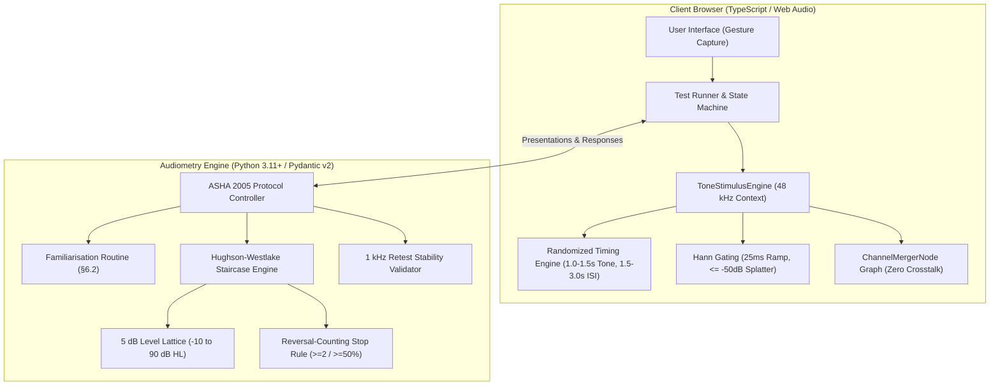

# AuroHear v2

> **A publication-ready, standards-compliant pure-tone threshold screening audiometer and digital audiology platform.**

[](https://www.asha.org)
[](https://www.thebsa.org.uk)
[](#standards-compliance)
[](https://www.python.org/)
[](https://www.typescriptlang.org/)
[](LICENSE)

---

## Executive Summary

**AuroHear v2** is an open-source, digital audiology system engineered for unsupervised and clinician-assisted air-conduction pure-tone threshold audiometry in standard modern web browsers.

Consumer web hearing tests routinely suffer from acoustic artifacts (transient clicks), lack of strict calibration limits, premature trial termination, and arbitrary decibel cutoffs. AuroHear v2 resolves these systematic errors by implementing:

1. **Mathematically Rigorous Adaptive Staircase (Hughson–Westlake)**: Ascending reversal-counting termination criteria ($ \ge 2 $ responses out of $ \ge 50\% $ ascending presentations) spanning −10 dB HL to 90 dB HL.
2. **Click-Free Web Audio Stimulus Engine**: Isolated dual-node gain architecture executing sampled Hann rise/fall envelopes (20–50 ms) to suppress transient spectral splatter ($ \le -50\text{ dB} $ off-frequency energy).
3. **Crosstalk Immunity by Construction**: Direct channel routing via Web Audio `ChannelMergerNode` ensuring absolute zero signal in the non-test ear.
4. **ASHA 2005 Protocol Sequencing**: Standardized test order starting at 1000 Hz, inter-octave evaluation, and automated 1000 Hz retest verification ($ |\Delta| > 5\text{ dB} $ session flagging).
5. **Rigorous Statistical & Property-Based Verification**: Validated via Hypothesis property testing, fast-check generative tests, and a 2,000-listener Monte Carlo simulation study.

---

## Standards Compliance

AuroHear v2 is developed against the following clinical and engineering benchmarks:

* **ASHA (2005)**: *Guidelines for Manual Pure-Tone Threshold Audiometry*
* **BSA (2018)**: *Recommended Procedure: Pure-tone air-conduction and bone-conduction threshold audiometry* (OD104-32)
* **ISO 8253-1 / ANSI S3.21**: *Acoustics — Audiometric test methods — Part 1: Pure-tone air and bone conduction audiometry*
* **IEC 60645-1**: *Electroacoustics — Audiometric equipment — Part 1: Equipment for pure-tone audiometry*
* **WHO (2021)**: *World report on hearing* (Hearing impairment grading and classification)

Detailed specifications and architectural analysis:
* [Browser Audiometry Digitization Spec](Browser_audiometry_digitization_spec.md)
* [Gap Analysis: V1 Prototype vs. Clinical Requirements](docs/GAP_ANALYSIS.md)
* [Conference Upgrade Strategy & Roadmap](docs/CONFERENCE_UPGRADE_STRATEGY.md)

---

## System Architecture



### 1. Pure-Tone Threshold Engine (`backend/src/aurohear/audiometry`)
A pure, event-driven core isolated from audio I/O and wall-clocks:
* **Level Lattice (`levels.py`)**: Quantized 5 dB grid from −10 dB HL up to 90 dB HL. Rejects arbitrary capping (e.g., v1's 40 dB HL limitation).
* **Clinical Models (`models.py`)**: Immutable Pydantic v2 domain schemas for `Presentation`, `StaircaseTrial`, `ThresholdResult`, and `ProtocolResult`. Enforces clinical validity at object creation.
* **Modified Hughson–Westlake (`staircase.py`)**: Strict 10 dB down on response, 5 dB up on non-response. Only ascending runs count toward threshold calculation.
* **Familiarisation (`familiarisation.py`)**: §6.2 procedure starting at 40 dB HL with stepped ascent until two consecutive responses at the same level.
* **ASHA 2005 Sequence (`protocol.py`)**: Order: 1000 Hz → 2000 → 3000 → 4000 → 6000 → 8000 → 1000 (retest) → 500 → 250 Hz. Completes better ear (or right if equal) before testing contralateral ear.

### 2. Acoustic Stimulus Engine (`frontend/src/audio`)
High-precision audio synthesis built on standard Web Audio primitives:
* **AudioContext Initialization (`ToneStimulusEngine.ts`)**: Bootstrapped strictly within user gestures at a 48 kHz sample rate.
* **Crosstalk Elimination**: Audio signal routes exclusively through a `ChannelMergerNode`. The untested ear channel remains completely disconnected, eliminating pan-law leakage by physical construction.
* **Hann Rise/Fall Windowing (`envelope.ts`)**: Sample-rate-accurate curve generated via `setValueCurveAtTime` (25 ms nominal, configurable 20–50 ms). Eliminates audible clicks and spectral artifacts.
* **Temporal Randomization (`timing.ts`)**: Uniformly distributed stimulus duration ($1.0\text{--}1.5\text{ s}$) and inter-stimulus interval ($1.5\text{--}3.0\text{ s}$). Enforces $\text{ISI} \ge \text{Tone Duration}$ on every draw to prevent rhythmic anticipation.
* **Transducer Calibration & Safety Clamping (`calibration.ts`)**: Converts dB HL to linear gain based on headphone profile offsets. Clamps output to hardware ceilings ($\le 90\text{ dB HL}$) and records Quality Control (QC) clamp events.

### 3. Clinical Classification & Uncertainty Modeling (`backend/src/aurohear/services/classification.py`)
Standards-based diagnostic and probabilistic outcome determination per spec §9:
* **Averages & Grades**: Pure-Tone Average ($\text{PTA}_4$ 500–4000 Hz) per ear, better-ear WHO (2021) Grade, and BSA 5-frequency descriptors (with No-Response counted as 130 dB HL per BSA).
* **Masalski Probabilistic Likelihood Model**: Calculates $P(\text{hearing loss}) = \Phi((\text{PTA} + \text{bias} - 20) / \sigma)$ using transducer calibration tier uncertainty bounds ($\sigma_{\text{Tier A}} = 4.5\text{ dB}$, $\sigma_{\text{Tier B}} = 5.4\text{ dB}$, $\sigma_{\text{Tier C}} = 7.6\text{ dB}$).
* **Categorical Risk Banding**: Low ($P < 0.25$), Medium ($0.25 \le P \le 0.75$), and High ($P > 0.75$).
* **Mandatory Clinical Overrides**: Automatic escalation to High risk and clinical referral upon asymmetry ($\ge 15\text{ dB}$ PTA difference or $\ge 20\text{ dB}$ across adjacent octaves), No-Response, or possible shadow thresholds ($\ge 40\text{ dB}$ supra-aural, $\ge 55\text{ dB}$ insert).
* **QUALIND-Informed Retest Invalidation**: Poor QC flags outcome as "Indeterminate — retest required" without masking necessary clinical referrals.

---

## Empirical & Statistical Validation

The algorithms have been subjected to extensive simulation and property testing:

| Metric / Test | Methodology | Finding / Performance |
| :--- | :--- | :--- |
| **Termination Safety** | Hypothesis property testing (unbounded responses) | Terminates in $\le 25$ presentations per frequency; never hangs |
| **Grid Adherence** | 10-down / 5-up invariant checks | 100% of stimuli land exactly on 5 dB lattice |
| **Stopping Rule Fidelity** | Simulated ideal observer | Thresholds match ground truth exactly across all levels and caps |
| **Staircase Accuracy** | Monte Carlo study ($N = 2,000$ realistic listeners) | Mean error: **+2.7 dB** (matches expected +2.5 dB grid discretization) |
| **Clinical Agreement** | Monte Carlo study ($N = 2,000$ realistic listeners) | **80.0% within 5 dB**, **99.8% within 10 dB** |
| **Contralateral Crosstalk** | Offline rendering across all frequencies and levels | **Exactly 0.000** in unselected channel |
| **Click & Splatter Suppression** | Fast Fourier onset energy evaluation | **$\le -50\text{ dB}$ off-frequency energy** ($\ge 25\text{ dB}$ improvement over hard gating) |
| **Gain Linearity** | Root-mean-square amplitude calculation | Rendered level matches formula to **within 0.05 dB** |

---

## Repository Structure

```text
Aurohear-v2/
├── backend/                       # Python clinical threshold engine
│   ├── pyproject.toml             # Packaging, Pydantic, pytest, and Hypothesis setup
│   ├── src/aurohear/
│   │   └── audiometry/
│   │       ├── familiarisation.py # §6.2 familiarisation sequence
│   │       ├── levels.py          # 5 dB HL lattice (-10 to 90 dB HL)
│   │       ├── models.py          # Strict Pydantic v2 schemas
│   │       ├── protocol.py        # ASHA 2005 sequence & 1 kHz retest validation
│   │       ├── simulation.py      # Synthetic listeners (ideal, psychometric, shifting)
│   │       └── staircase.py       # Hughson-Westlake 10-down/5-up staircase
│   └── tests/                     # Test bench (unit, property, Monte Carlo)
│       ├── test_accuracy_montecarlo.py # 2,000-listener validation study
│       ├── test_familiarisation.py
│       ├── test_levels.py
│       ├── test_protocol.py
│       ├── test_protocol_properties.py
│       ├── test_staircase.py
│       └── test_staircase_properties.py
│
├── frontend/                      # Web Audio tone generation subsystem
│   ├── package.json               # TypeScript 5, Vitest 5, fast-check
│   ├── tsconfig.json
│   ├── src/audio/
│   │   ├── ToneStimulusEngine.ts  # Web Audio synthesis & routing graph
│   │   ├── calibration.ts         # dB HL to linear gain conversion & safety cap
│   │   ├── envelope.ts            # Hann rise/fall curve generation
│   │   ├── timing.ts              # Randomized stimulus & ISI timers
│   │   └── types.ts               # Audio interfaces & type definitions
│   └── tests/                     # Acoustic rendering validation suite
│       ├── ToneStimulusEngine.test.ts # Crosstalk, splatter, and gain tests
│       ├── calibration.test.ts
│       ├── envelope.test.ts
│       ├── timing.test.ts
│       └── helpers.ts
│
├── docs/                          # Clinical specifications and gap analyses
│   ├── Browser_audiometry_digitization_spec.md
│   ├── CONFERENCE_UPGRADE_STRATEGY.md
│   └── GAP_ANALYSIS.md
└── LICENSE                        # MIT License
```

---

## Quickstart & Testing

### Backend Engine

**Prerequisites**: Python 3.11+

```bash
# Navigate to backend directory
cd backend

# Create and activate virtual environment
python -m venv .venv
source .venv/bin/activate  # On Windows: .venv\Scripts\activate

# Install dependencies in editable mode
pip install -e ".[dev]"

# Run full test suite (unit + property-based + Monte Carlo)
python -m pytest -q
```

### Frontend Audio Engine

**Prerequisites**: Node.js 18+ (Node 20+ recommended)

```bash
# Navigate to frontend directory
cd frontend

# Install dependencies
npm install

# Run static type check
npm run typecheck

# Execute offline audio rendering test suite
npm test
```

---

## Clinical Trade-Offs & Design Rationale

1. **Staircase Discretization (+2.5 dB Expected Bias)**: Because the staircase evaluates on a 5 dB grid and identifies the lowest level at which $\ge 50\%$ of ascending presentations are heard, the reported threshold will naturally reflect the first 5 dB step at or above the listener's true continuous perceptual threshold. In clinical audiometers, this causes an expected bias of approximately +2.5 dB, mirrored in our Monte Carlo findings (+2.7 dB).
2. **Sub-Zero Threshold Floor (−10 dB HL)**: Thresholds at −10 dB HL cannot be approached from below. In accordance with clinical practice, repeated responses at −10 dB HL are recorded and classified as $\le -10\text{ dB HL}$.
3. **Safety Limit vs. Termination**: Presentations are capped at 6 ascending runs and a maximum of 25 presentations per frequency. Exceeding these limits marks the frequency as *unresolved* rather than outputting an invalid threshold estimate.
4. **1 kHz Retest Discrepancy Protocol**: A difference of $|\text{Threshold}_{\text{retest}} - \text{Threshold}_{\text{initial}}| > 5\text{ dB}$ flags the session for clinician review. Following ASHA conventions, the lower (more acute) threshold is recorded for clinical display.

---

## Project Roadmap

- [x] **Phase 1: Hughson–Westlake Engine**: Completed with 1000 Hz familiarisation, ascending reversal stop rule, and ASHA 2005 sequence ([`backend/`](backend/)).
- [x] **Phase 2: Acoustic Stimulus Synthesis**: Completed with 48 kHz Web Audio engine, zero-crosstalk merger routing, and Hann envelope smoothing ([`frontend/`](frontend/)).
- [x] **Phase 3: Client State Machine (FSM) & API Adapter**: Completed with XState v5 test runner, timestamped window scoring, catch-trial distribution, transition audit logging, and `ApiSessionClient` ([`frontend/src/session/`](frontend/src/session/), [`frontend/src/api/`](frontend/src/api/)).
- [x] **Clinical Classification & Probabilistic Uncertainty**: Completed with WHO (2021) grading, BSA (2018) descriptors, Masalski $\sigma$-tier likelihood model, and mandatory clinical referral overrides ([`backend/src/aurohear/services/classification.py`](backend/src/aurohear/services/classification.py)).
- [ ] **Phase 4: Ambient Noise & Hardware Watchdog**: Ambient room noise gating via `AnalyserNode` and headphone unplug detection.
- [ ] **Phase 5: Clinical Validation Study**: Multi-site comparative trial benchmarking AuroHear v2 against certified clinical audiometers.

---

## License

This project is licensed under the MIT License — see the [LICENSE](LICENSE) file for details.
